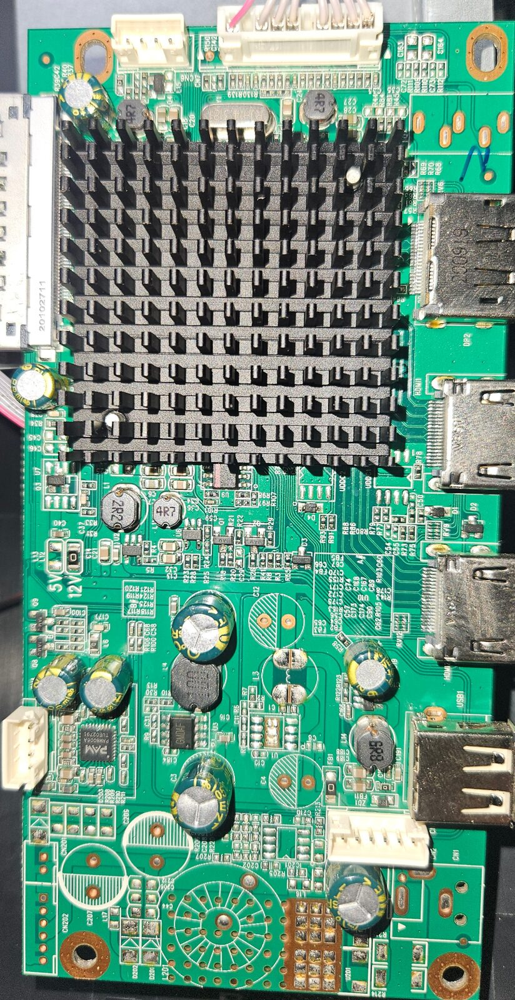
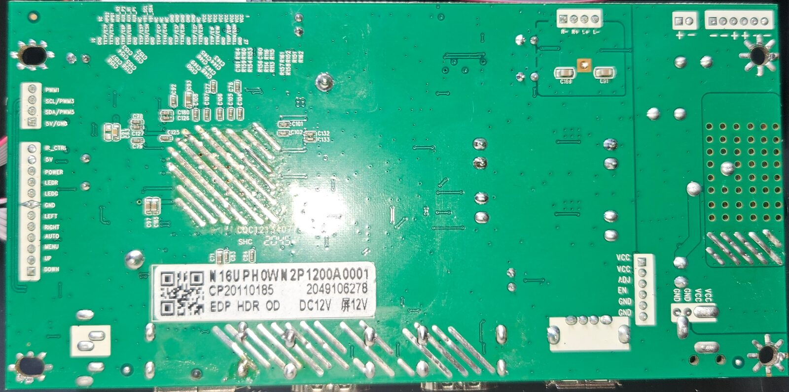
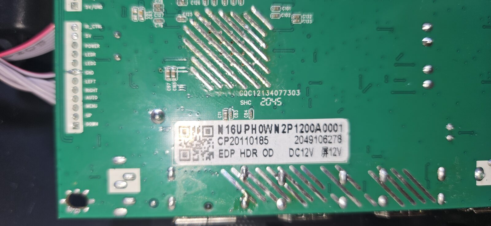
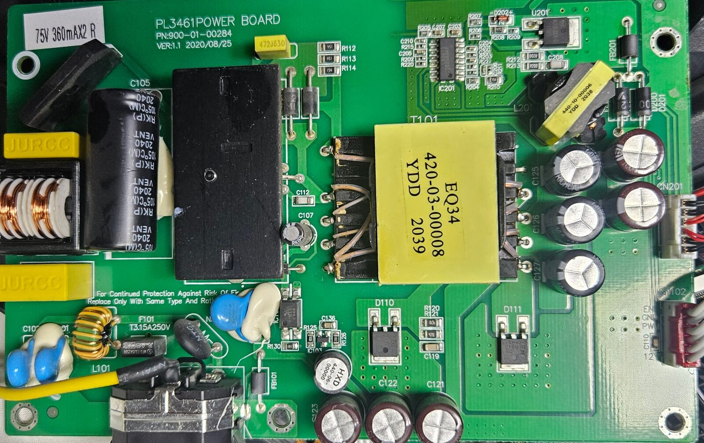
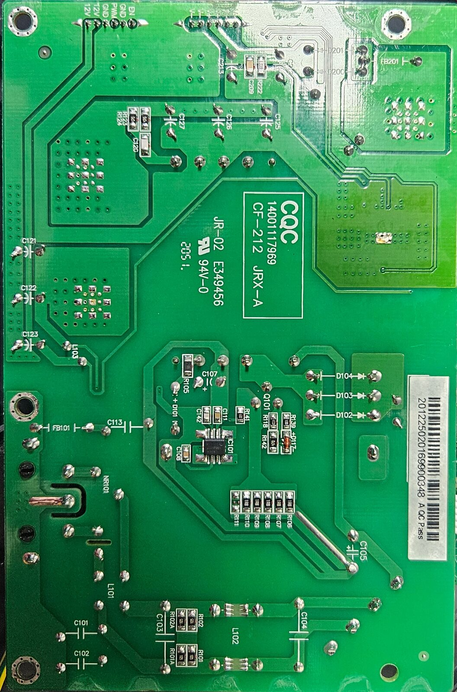

# Boards: main (scaler) board and power supply (photos 2026-11-13)

- Source: 25 photos by Dan, 2026-11-13 08:45–10:18 (+11:00).
  - Full size: [photos/full/](photos/full/) (all 25, pixels unchanged, GPS EXIF removed: `scripts/doc_photos.py --full`).
  - Reduced copies used inline here: `photos/` (`scripts/doc_photos.py`); full-size source per reduced copy in [Photo index](#photo-index).
- Unit photographed: not recorded [?].
- Tags: [photo] = read clearly; [photo?] = partly readable, best guess; not visible = says so.
- Not photographed yet: scaler and flash (under the heatsink), keypad board, enclosure label, PSU IC101 marking, a sharp crystal shot.

## Main (scaler) board
 

- Sticker [photo]: `N16UPH0WN2P1200A0001` / `CP20110185` / `2049106278` / `EDP HDR OD` / `DC12V` / `屏12V` (panel 12 V). 
- PCB marking [photo]: `CQC12134077303` / `SHC` / `2045` (probably 2020 week 45).
- No `JXC`, `Dahua`, `LM27-F410` or `demoset` text anywhere: the LM27-F410 match ([rtd2795t-generic-board-match.md](rtd2795t-generic-board-match.md)) is neither confirmed nor ruled out.

### Parts
| ref | part | marking | tag | role |
|---|---|---|---|---|
| (scaler) | RTD2795T | under heatsink | not visible | scaler + 8051 MCU |
| (flash) | SPI NOR, JEDEC c22014 [hw] | not seen on either side | not visible | firmware; probably under the heatsink |
| — | speaker amp **PAM8006A** (Diodes/PAM stereo class-D, DC volume control) | `PAM8006A` / `TUE0279` | [photo] | left edge, next to speaker header CN4 ([photo](photos/main-amp-pam8006a.jpg)) |
| Y1 | crystal, HC-49S | `…14.318…` | [photo?] | 14.318 MHz unconfirmed |
| U3 | SOIC-8 buck (L4 next to it) | `GMDAF` | [photo?] | probably 12 V → 5 V |
| U2, U6 | SOT-23-6 bucks (L1 2R2, L2 4R7) | `WF5J` / `018R` | [photo?] | core rails |
| U7 | SOT-23 | `1407A` / `RM01` | [photo?] | ? |
| Q1, Q2, Q8, Q9 | SOT-23 NPN | `1AM` (= MMBT3904 class) | [photo] | switches |
| VDDC1/2 | TO-252 / SOT-223 footprints | VDDC1 looks empty | [photo?] | |
| L201, U201, D201/202, C205–209, CN201/CN202 | LED boost section | **unpopulated** | [photo] | backlight driver lives on the PSU instead |
| U1, L3, C4, C12 | footprints | **unpopulated** | [photo] | |

### Connectors (bottom silkscreen) [photo]
| header | pins | goes to |
|---|---|---|
| keypad, 12-pin | IR_CTRL, 5V, POWER, LEDR, LEDG, GND, LEFT, RIGHT, AUTO, MENU, UP, DOWN | keypad board (ribbon fitted); IR comes in here (no IR receiver on the main board) ([photo](photos/main-keypad-header.jpg)) |
| aux, 4-pin | PWM1, SCL/PWM3, SDA/PWM5, 5V/GND | nothing plugged in |
| speaker CN4, 4-pin | R−, R+, L+, L− | speakers (fitted in the monitor, unplugged for the photos, Dan 2026-11-13) ([photo](photos/main-speaker-header.jpg)) |
| backlight control, 6-pin | VCC, VCC, ADJ, EN, GND, GND | PSU CN102 (12 V in + BL enable/PWM) ([photo](photos/main-bl-header.jpg)) |
| power pads | VCC, VCC, GND, GND | unpopulated (alternative power input) |
| panel, 51-pin micro-coax | VCC ×~10, GND, TX0–TX7 (labelled TXn/En: V-by-One or eDP), AUX_P1/N1, HPD1, AUX_P2/N2, HPD2, VB1_SCL, VB1_SDA | panel ([photo](photos/main-panel-connector.jpg)) |
| rear I/O | `USB1` (USB-A), `HDMI2`, `HDMI1`, `DP2` | "DP2" implies an unfitted DP1 |

- Panel VCC jumper `5V` / `12V`: 0 Ω on **12V** [photo] (matches the panel's 12 V).
- **No 3.5 mm headphone jack.** Empty footprint next to DP2 (5 oval slots + 1 round pad, near R68–R70, RV6, hand-drawn "2"): possibly the jack [photo?] ([photo](photos/main-io-empty-footprint.jpg)). Second empty 3-slot footprint at CN1, bottom right: possibly a DC jack [photo?].
- No labelled UART/ISP pads; the SCL/SDA aux header is the likely I2C access point [?].
- Flux residue on the bottom around the scaler area.

## Power supply board
 

- Board [photo]: `PL3461POWER BOARD`, `PN:900-01-00284`, `VER:1.1 2020/08/25`; bottom `CQC 14001117969 CF-212 JRX-A`, `JR-02 E349456 94V-0 2051`; barcode `20122502016990034 8 A QC Pass`.
- Backlight sticker [photo]: `75V 360mAX2 R` = 2 LED strings, 75 V, 360 mA each.
- **Output: 12 V only** [photo]; 5 V / 3.3 V are made on the main board.

| ref | part | marking | tag | role |
|---|---|---|---|---|
| IC201 | **OB3363HP** (On-Bright 2-channel LED backlight controller), SOP-16 | `OB3363HP` / `L32010` / `P` | [photo] | backlight driver ([photo](photos/psu-led-driver-ob3363.jpg)) |
| U201 | TO-252 MOSFET | `…E01 30PA…` | [photo?] | boost switch |
| L201 | boost inductor | `440-10-00006 YDD 2038` | [photo] | |
| R212, R213 | current sense | `R200` (0.2 Ω) | [photo] | LED string current |
| T101 | main transformer EQ34 | `EQ34 420-03-00008 YDD 2039` | [photo] | |
| IC101 | primary PWM controller, SOIC-8 (bottom) | not readable | not visible | |
| — | PFC | no PFC choke/controller seen | [photo] | bulk cap C105 RK(P) 105 °C, date 2040 |
| F101 | fuse | `T3.15A250V` | [photo] | + NTC, CM choke L101, `JURCC` X-caps, optocoupler, IC103 (SOT-23, TL431-class [?]) |
| D110, D111 | TO-252 Schottky | D110 `MBRD20150…` | [photo?] | 12 V rectifier |
| C121–C127 | output caps RICHCAP; toroid `HXD 440-06-00000` | | [photo] | |

### Connectors [photo]
| header | pins | goes to |
|---|---|---|
| CN102 (red) | EN, GND, PWM, GND, 12V, 12V | main board backlight-control header ([photo](photos/psu-connectors.jpg)) |
| CN201 | V−, V−, V+, V+, V−, V− | panel LED strings (2) |

## Panel
- Label [photo]: `INNOLUX M280DCA-E3B Rev. C1`, serial `0AC1C2N0984004J`, `CMS0A3B1CZTN3NPC0980106`, `PZO0LJX07500032`, `C8B905DVV511111000G86C` ([photo](photos/panel-label.jpg)). Spec: [panel-innolux-m280dca-e3b.md](panel-innolux-m280dca-e3b.md).
- Fed directly over the 51-pin eDP micro-coax; no separate T-con board photographed.

## Checks against earlier assumptions
| assumption | result |
|---|---|
| panel M280DCA-E3B rev C1, eDP, 12 V | confirmed: label, sticker `EDP` / `屏12V`, jumper on 12V |
| speaker amp on P7.4 (enable) / P7.3 (mute), fed from aout 116/117 ([audio.md](../audio.md)) | traces under the heatsink; consistent with the PAM8006A (stereo in, shutdown and mute pins) |
| P4.5 (pin 113) = jack detect | no jack fitted; possible empty jack footprint by DP2 |
| speakers fitted | yes (Dan 2026-11-13): fitted, just not in the photos; CN4 unplugged for the photos |
| backlight driver on the main board | no: main-board boost section unpopulated; OB3363HP on the PSU drives 2 strings |

## Photo index
| full size | reduced copy |
|---|---|
| [20261113_084510](photos/full/20261113_084510.jpg) | main-top |
| [20261113_084706](photos/full/20261113_084706.jpg) | main-bottom |
| [20261113_084555](photos/full/20261113_084555.jpg) | main-amp-pam8006a |
| [20261113_084709](photos/full/20261113_084709.jpg) | main-sticker |
| [20261113_084731](photos/full/20261113_084731.jpg) | main-keypad-header |
| [20261113_084737](photos/full/20261113_084737.jpg) | main-panel-connector |
| [20261113_084745](photos/full/20261113_084745.jpg) | main-speaker-header |
| [20261113_084758](photos/full/20261113_084758.jpg) | main-bl-header |
| [20261113_084514](photos/full/20261113_084514.jpg) | main-io-empty-footprint |
| [20261113_085447](photos/full/20261113_085447.jpg) | panel-label |
| [20261113_101631](photos/full/20261113_101631.jpg) | psu-top |
| [20261113_101529](photos/full/20261113_101529.jpg) | psu-bottom |
| [20261113_101545](photos/full/20261113_101545.jpg) | psu-connectors |
| [20261113_101750](photos/full/20261113_101750.jpg) | psu-led-driver-ob3363 |
| 084508, 084522, 084528, 084609, 084633, 101533, 101537, 101558, 101603, 101626, 101800 | none (other angles; all in [photos/full/](photos/full/)) |
